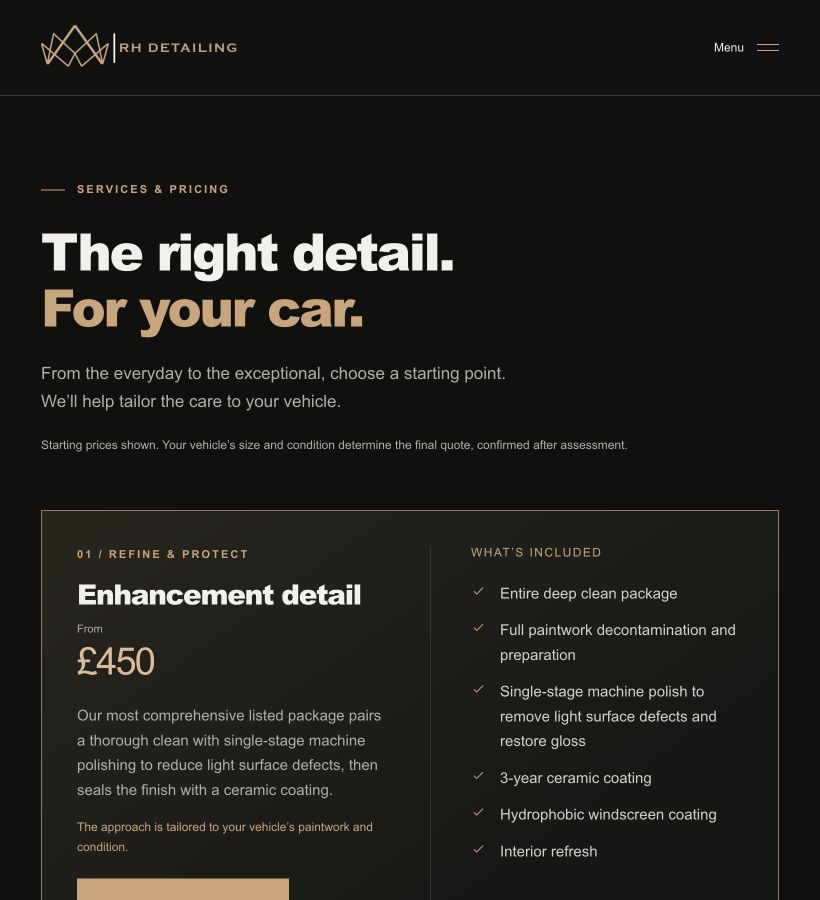
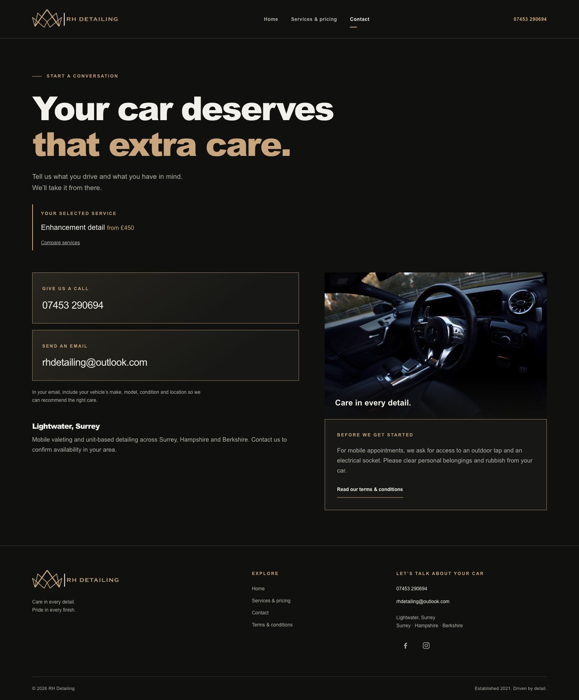

# Design audit fixes — 23 October 2026

Implemented the six priority recommendations from the approved [design review](design-review-2026-10-23.md), preserving the established branding, content, video and page structure.

## Changes

1. Added shared body, control, supporting-text and label size tokens. Substantive small body copy now uses 15px; controls/supporting text use 12px and short labels 11px. Small-screen page headings reduce to 34px at widths of 380px or less, preventing the Contact introduction from splitting into four lines at 320px.
2. Package headings and prices use a defined grid on wide screens. At 1100px and below, every package consistently places its price underneath the heading.
3. The mobile hero explicitly separates the place and establishment date into two lines. The redundant Surrey mention in the eyebrow was removed; Surrey remains in the location metadata. SVG play/pause icons replace platform-dependent text glyphs. Mobile hero content can grow safely without covering the metadata or playback button.
4. Selected-service context now sits in the Contact introduction above both columns, so it cannot push only the phone/email column downwards. Service-specific email subjects remain intact.
5. The generic introduction-paragraph rule excludes the pricing note. The note now renders at the intended supporting-copy size, 12px.
6. Removed the additional package scroll margin. The shared root scroll padding provides the single header-aware anchor offset.

## Verification

- Formatting, all four existing tests and production build passed.
- At 320px: no horizontal overflow observed on Home or Contact; location metadata is two deliberate lines with no overlap with playback controls. Contact heading measures 110px high at 34px type, down from four lines before the fix.
- At 820px: all four package prices are below their titles; all category labels render at 11px, caveat at 12px and package body copy at 15px. No horizontal overflow observed.
- At 1440px: all package prices stay alongside titles. Selected-service Contact cards and image both start at the same vertical position (678.2px in the checked viewport).
- Deep Clean anchor at desktop lands 120px from the viewport top: 96px header plus 24px breathing room, with no duplicated offset.
- Mobile menu closes with Escape and returns focus to the toggle.
- Video pause/resume and SVG playback icon verified in browser.
- Selected Enhancement Detail enquiry retains `mailto:rhdetailing@outlook.com?subject=Enquiry%3A%20Enhancement%20detail`.

The original video remains unchanged. Separate compression, Google review integration and replacement photography were further considerations, not part of these six fixes.

## Screenshots

