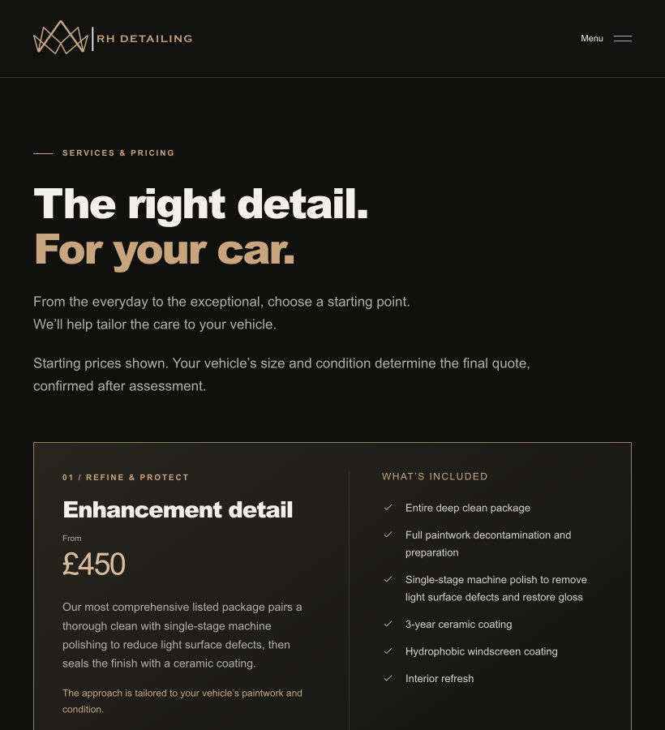
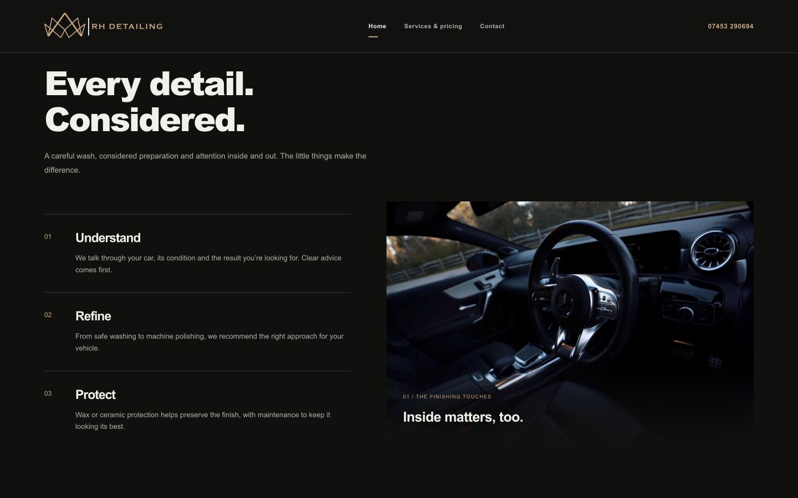

# Frontend design and UX review

Reviewed on 23 October 2026 using the frontend-design skill, the current source and the local browser preview.

**Follow-up:** The six priority fixes below were implemented and verified after approval. See [the implementation record](design-polish-2026-10-23.md). The findings and original screenshots below document the pre-fix state.

## Assessment

The established black-and-gold direction is coherent and appropriate for the business. Keep the original logo, real video, gold package borders, restrained controls, left-aligned introductions and alternating homepage imagery. A wholesale redesign would undo decisions already approved by the owner.

The skill's prescribed aesthetic anchors conflict with the explicit requirement to preserve RH Detailing's brand. This review therefore applies its hierarchy, consistency, interaction and content checks within the approved brand. No application styling or behaviour was changed during this audit.

## Recommended improvements, in order

### 1. Improve the small-text hierarchy

**Impact:** readability, especially on mobile and for less confident readers.

Desktop navigation is 11px, button labels 10–11px, service-category labels 8px, footer metadata 9px and much supporting copy 13px. These are noticeably small against the oversized headings. This is a legibility finding, not a claim that a specific font size automatically fails WCAG.

Use a deliberate shared type scale: approximately 15–16px for substantive body copy, 12–13px for navigation and controls, and at least 10–11px for short supporting labels. Recheck wrapping after increasing sizes. Keep the bold headings, but reduce the smallest-screen page-title size enough to avoid excessive four-line introductions.

**Source:** `src/styles/tokens.css`, `src/styles/global.css`, `src/styles/components.css`.

### 2. Stabilise package price positions at tablet widths

**Impact:** package comparison and visual consistency.

At 820px, Enhancement Detail and Maintenance put their prices below the title, while Deep Clean and Mini Valet retain prices beside it. The wrapping flex row makes the layout depend on title length.

Give every package the same price placement at a given breakpoint. Keep a defined title/price grid on wide screens and switch every package to a consistent stacked layout when that grid becomes too narrow. Preserve prices, full inclusions and enquiry links.

**Source:** `.package-title-row` in `src/styles/components.css`.

### 3. Give the mobile hero metadata an intentional layout

**Impact:** the finish of the most prominent section.

At 320px, the reserved 140px for the video button leaves the location text only 132px wide. Lightwater, Surrey and the establishment year break into three awkward lines. At 390px it still wraps into two lines. There is no overlap, but the desktop alignment does not translate gracefully.

Separate the location and establishment date into explicit text elements. Use controlled mobile line breaks, remove the decorative separator at that breakpoint and keep the video control in a compact, aligned position. Replace the Unicode play/pause glyphs with small SVG icons so their appearance is consistent between platforms.

**Source:** `.hero-bottom`, `.hero-location`, `.gold-dot` and `src/components/HeroMedia.jsx`.

### 4. Preserve Contact-page alignment when a service is selected

**Impact:** consistency on the real enquiry journey.

The default Contact page aligns the contact options and image, but arriving from a service inserts the selected-service block into only the left column. At 1024px, the contact options start about 142px below the image. The selected service and encoded email subject are otherwise correct.

Move the selected-service context above the two-column content grid, or reserve a separate context row shared by both columns. Keep the service name, starting price and Compare Services link visible.

**Source:** `src/pages/ContactPage.jsx`, `.selected-service`.

### 5. Correct the pricing-note typography override

**Impact:** secondary copy competes with introductory copy.

The pricing caveat is intended to be 12px in `.pricing-intro .pricing-note`, but `.page-intro > p:not(.eyebrow)` is more specific and wins. The browser renders it at 17px on desktop/tablet, equal to the introduction. This also makes apparent design intent disagree with the CSS outcome.

Define an explicit supporting-copy class or exclude the note from the generic intro rule. Use the revised shared secondary-text size rather than adding another isolated exception.

**Source:** `src/styles/global.css`, `src/styles/components.css`.

### 6. Remove the double anchor offset

**Impact:** navigation from a homepage service card leaves an unnecessarily large gap above the selected package.

On a 390px viewport, the header is 78px tall. Both root scroll padding and package scroll margin add 102px, so the package lands approximately 204px from the viewport top. That leaves around 126px of space beneath the header.

Retain a single header-aware offset, with a modest visual gap, rather than applying the complete offset twice.

**Source:** `html` in `src/styles/global.css` and `.package` in `src/styles/components.css`.

## Further improvements worth considering

- The original hero video is 52.35 seconds and 15,650,595 bytes (about 15.7 MB decimal). Reduced-motion/data-saving fallbacks are already implemented, but a separately compressed version would improve ordinary mobile loading. Preserve the original film and poster; avoid changing the approved hero content.
- The same interior photograph appears on Home and Contact. It is legitimate source imagery, but a different real photograph would make Contact feel more purposeful. A small genuine before/after selection would explain correction work better than adding more marketing text.
- Google reviews remain a useful trust-content addition, subject to choosing a real integration. Do not hardcode an unverified rating or invent testimonials.
- The image caption's decorative `01 / THE FINISHING TOUCHES` adds little information. A simpler caption would follow the skill's content discipline more closely.
- Retire unused `.section-intro` styles and rename the reused `.services-intro` class to a page-neutral name during a future code cleanup. This is maintainability polish, not a visible defect.

## What was verified

- Home, Services & Pricing, Contact and Terms reviewed in the browser and source.
- Targeted viewport checks at widths of 320, 390, 820, 1024 and 1440px. Not an exhaustive browser/device matrix.
- No horizontal page overflow observed on the checked routes and viewports.
- Desktop header plus hero measured exactly 900px in a 900px-high viewport.
- Mobile menu closes with Escape and returns focus to its toggle.
- Whole-card keyboard activation reaches the correct package anchor.
- Service enquiries carry the correct service into Contact and the email subject.
- Homepage photographs load when their sections are reached; lazy images were checked in view rather than judged from an offscreen full-page capture.
- Terms render all six existing sections.
- `npm --userconfig=/dev/null run check`: formatting passed, four tests passed, production build passed.

The brand palette, consistent card borders, focus rings, footer social icons and alternating image/list layout are strengths to retain. No new dependencies or external services are needed for the six priority fixes.

